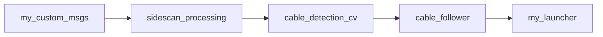

# Méthode de travail

Le projet est reconstruit package par package dans mon workspace personnel (`ros2_ws_sss_project/`), dans l'ordre
des dépendances puisque chaque package a besoin du précédent.

## 1. Les étapes pour chaque package

1. Je copie le package dans mon workspace ;
2. Je lis chaque fichier afin de comprendre son rôle ;
3. Je compile ;
4. Je vérifie ensuite avec l'enregistrement ;
5. Je prends ensuite des notes de ce qui a été observé, si c'est le cas.

```bash
cp -r /project/ros2_ws_sss/src/<package> /project/ros2_ws_sss_project/src/
cd /project/ros2_ws_sss_project
source /opt/ros/humble/setup.bash
colcon build
source install/setup.bash
```

## 2. Ordre de lecture



`my_custom_msgs` est compilé en premier : tous les autres packages utilisent ses messages.

## 3. Préparer un terminal

!!! note "« Sourcer »"
    `source <fichier>/setup.bash` indique au terminal où trouver ROS 2 et nos packages.
    Cela vaut pour un terminal, pas pour un dossier : chaque nouvelle fenêtre doit le refaire.

Sur la carte (dans le conteneur) :

```bash
source /opt/ros/humble/setup.bash
cd /project/ros2_ws_sss_project
source install/setup.bash
```

!!! tip "Plus besoin de sourcer à la main"
    Pour ne plus retaper ces lignes, elles sont ajoutées au `~/.bashrc` du conteneur :
    ```bash
    echo "source /opt/ros/humble/setup.bash" >> ~/.bashrc
    echo "source /project/ros2_ws_sss_project/install/setup.bash" >> ~/.bashrc
    ```
    Chaque nouveau terminal ouvert avec `ros` est alors prêt directement.
    Après un `colcon build` qui ajoute un nouveau package, refaire
    `source install/setup.bash` dans les terminaux déjà ouverts.

Lorsqu'un terminal n'est pas sourcé on a :
`The message type 'my_custom_msgs/msg/SideScanSonar' is invalid` ou
`package 'my_custom_msgs' not found` qui s'affiche.

## 4. Rejouer l'enregistrement

```bash
ros2 bag play <chemin>/cable_test_20261012_203459/ \ 
    --loop --topics /unity_simulation/side_scan_data
```

## 5. Quelques Commandes de lancement et vérification

| Commande | Ce qu'elle indique |
|---|---|
| `ros2 run` ou `ros2 launch` | Pour lancer un nœud |
| `ros2 node list` | Les nœuds en cours d'exécution |
| `ros2 topic list` | Les topics existants |
| `ros2 topic info <topic> -v` | Le type, qui publie et qui s'abonne |
| `ros2 topic hz <topic>` | Le nombre de messages par seconde |
| `ros2 topic echo <topic>` | Le contenu des messages |
| `ros2 interface show <type>` | La définition d'un message |
