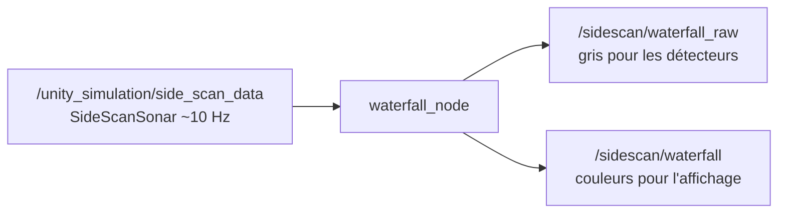

# sidescan_processing : transforme des pings à l'image waterfall

## 1. Principe

Un seul nœud, `waterfall_node`, transforme les pings en image.



## 2. Les notions clés

### Une ligne par ping

Les deux tableaux du ping vont du proche vers le loin. Bâbord est inversé pour que
l'image soit naturelle :

```
ligne de l'image = [loin ...... proche][proche ...... loin]
                    ◄──── bâbord ────► ▲ ◄──── tribord ───►
                                     nadir (colonne d'eau au centre)
```

## 3. Test sur la carte (14/10/2026)

| Fenêtre | Rôle | Commande |
|---|---|---|
| 1 | Je Lance le nœud | `ros2 launch sidescan_processing sidescan_processing.launch.py` |
| 2 | Envoies des pings | `ros2 bag play <bag> --topics /unity_simulation/side_scan_data --loop` |
| 3 | On vérifie | `ros2 topic info /sidescan/waterfall -v`, `ros2 topic hz /sidescan/waterfall` |

Résultats :

- On observe `Buffer initialized: 1024 x 2000 px` : le nœud reçoit les pings (2000 px = bâbord + tribord) ;
- `ros2 topic hz /sidescan/waterfall` ≈ Nous avons une image par ping. 

| Ce qu'on voit | Signification |
|---|---|
| `Publisher count: 0` | Le nœud n'est pas encore lancé |
| `Publisher count: 2` | Le bag publie aussi l'image et donc on ajoute `--topics` pour n'envoyer que les pings |
| `message type ... is invalid` | Quand le terminal n'est pas sourcé |
