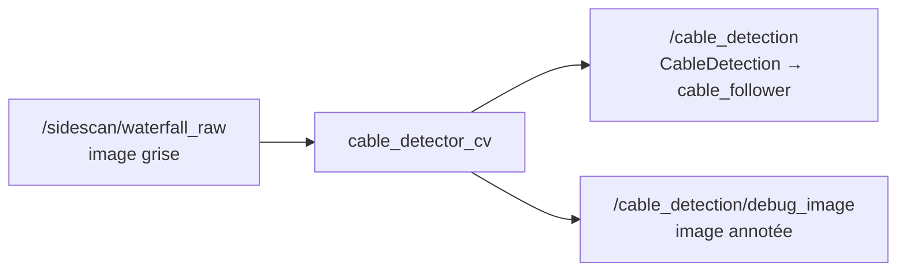

# cable_detection_cv : retrouver le câble dans l'image

## 1. Principe

Nous avons un seul nœud, `cable_detector_cv`. Il cherche une ligne droite dans l'image waterfall avec du traitement d'image classique (OpenCV, sans IA).



## 2. Test sur la carte (15/10/2026)

| Fenêtre | Commande |
|---|---|
| 1 | `ros2 launch sidescan_processing sidescan_processing.launch.py` |
| 2 | `ros2 launch cable_detection_cv cable_detection_cv.launch.py` |
| 3 | `ros2 bag play <bag> --loop --topics /unity_simulation/side_scan_data` |
| 4 | `ros2 topic echo /cable_detection`, `ros2 topic hz /cable_detection` |

Le bag ne contient pas `/sidescan/waterfall_raw` : `waterfall_node` doit tourner.

Aperçu du Résultat :

```
detected: true
confidence: 0.77
p1: {x: 445, y: 0}   p2: {x: 446, y: 1023}
angle_rad: 1.9e-05
lateral_offset_px: -554.5
```