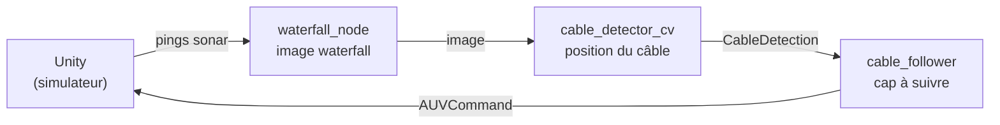

# Prise en main du projet

Cette documentation est la deuxième partie du travail. La première partie (installation de Debian, du Wi-Fi, de Docker et de ROS 2 sur la HummingBoard) est décrite dans la documentation HUMMINGBOARD 8P EDGE AI.

Nous avons un AUV (robot sous-marin autonome), simulé dans Unity, qui suit un câble posé au fond grâce à son sonar à balayage latéral.

## Chaîne de traitement

## Avancement (semaine du 12/10/2026)

| # | Package | Rôle | État |
|---|---|---|---|
| 1 | `my_custom_msgs` | Formats des messages échangés | Compilé et vérifié |
| 2 | `sidescan_processing` | Pings (image waterfall) | Compilé et testé sur la carte |
| 3 | `cable_detection_cv` | Image (position du câble) | Compilé sur la carte, câble détecté (≈ 2,9 Hz) |
| 4 | `cable_follower` | Position du câble | Compilé pour le suivi |
| 5 | `my_launcher` | Lance toute la chaîne | Pas encore testé |
| — | `ROS-TCP-Endpoint` | Pont Unity et ROS | Pas nécessaire pour l'instant |
| — | `cable_detection_ai` | Détection par IA | Fallait que j'active la carte graphique |

!!! note "Changement d'environnement"
    Les deux premiers packages ont été étudiés sur le PC avec un environnement (ROS 2 Lyrical).
    À partir de `sidescan_processing`, j'ai décidé de continuer tout le travail directement sur la carte en SSH avec un environnement (ROS 2 Humble), voir [Travail sur la carte (SSH)](03_carte_ssh.md).

## Pages

1. [Principe du projet](01_principe.md) : sonar latéral, image waterfall, chaîne ROS 2
2. [Méthode de travail](02_methode.md) : copier, lire, compiler, vérifier avec l'enregistrement
3. [Travail sur la carte (SSH)](03_carte_ssh.md) : pourquoi et comment
4. [my_custom_msgs](04_my_custom_msgs.md) : les messages
5. [sidescan_processing](05_sidescan_processing.md) : construction de l'image
6. [cable_detection_cv](06_cable_detection_cv.md) : détection du câble
7. [Suite](07_suite.md)
